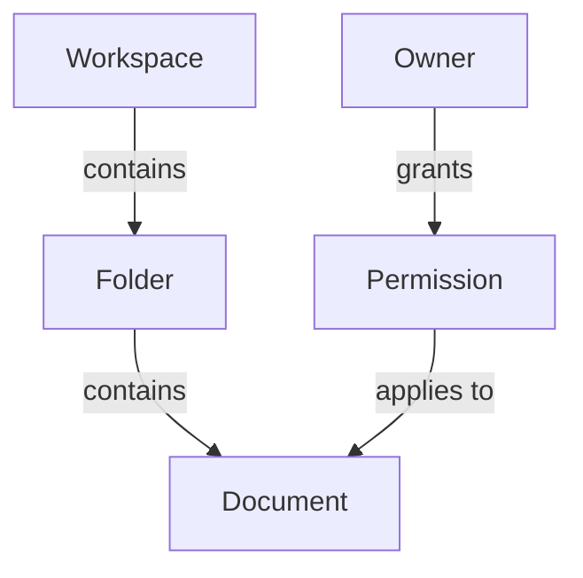

# Concept Map

Turn the user's topic into a focus question, a sorted list of entities, a map of labeled relationships, and the knowledge gaps it exposes.

## Input

Work from the user's context (docs, code, notes, conversation). Infer what you can and state assumptions. Ask only for gaps that block a correct map (one round, max 3 questions). The map is only as accurate as the knowledge behind it: read the available sources first, and where knowledge is thin, say so.

## Steps

1. **Focus question.** Write one question the map answers ("What controls who can see a shared file in this app?"). Choose the angle: inner workings, or relationships with the surroundings.
2. **Entities.** List 15-25 entities relevant to the focus question: people, roles, objects, places, organizations, actions, processes, methods. Drop any that do not serve the question.
3. **Sort.** Order the list from most general to most specific. This becomes the map's hierarchy.
4. **Link.** Connect entities with arrows labeled by a verb phrase ("contains", "is assigned to", "creates", "depends on"). Each entity-link-entity triple must read as a true sentence. Done when every entity is linked and every triple reads as a sentence.
5. **Cross-links.** Add links between distant branches; these often hold the key insight.
6. **Gaps.** List the relationships you could not determine, statements that need verification, and questions the map raises about how it could work better.

## Output

````markdown
## Focus question
<...>

## Entities (general -> specific)
1. <...>

## Map


## Key propositions
- <entity> <verb phrase> <entity>

## Gaps and questions
- <...>
````

## Related

- `connection-circles` when the relationships are causal and you need feedback loops.
- `issue-trees` to break down a problem instead of a concept.

Source: https://untools.co/concept-map/
