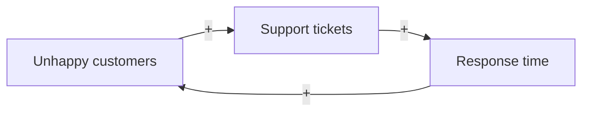

# Connection Circles

Turn the user's story or system into key elements, signed cause-effect links, and the feedback loops they form.

## Input

Work from the user's context. Infer what you can and state assumptions. Ask only for gaps that block a correct map (one round, max 3 questions). The minimum input is a story, situation, or system description.

## Steps

1. **Elements.** Pick up to 10 key elements. Each must matter to how the system changes, be able to increase or decrease, and be a noun phrase ("support tickets", "response time", not "slow support").
2. **Links.** For each pair where one element directly causes the other to change, draw an arrow from cause to effect. Mark the effect:
   - **+**: they move in the same direction (more A -> more B).
   - **-**: they move in opposite directions (more A -> less B).
   Mark each link as based on data or a hypothesis. Done when every direct cause-effect relationship in the input is a link.
3. **Loops.** Find every closed path of arrows. Classify each:
   - **Reinforcing (R):** even number of "-" links; it amplifies change (vicious or virtuous cycle).
   - **Balancing (B):** odd number of "-" links; it pushes toward stability.
4. **Insight.** Explain what the loops reveal about the system's behavior, and name the link or element where an intervention would have the most effect.

## Output

````markdown
## Elements
<list>

## Map


## Links
| From | To | Sign | Basis |
|---|---|---|---|

## Feedback loops
- **R1:** A -> B -> C -> A - <what it does>
- **B1:** ...

## Insight and leverage
<...>
````

## Related

- `reinforcing-feedback-loop` and `balancing-feedback-loop` to analyze a loop in depth.
- `iceberg-model` to connect the loops to mental models.

Source: https://untools.co/connection-circles/
