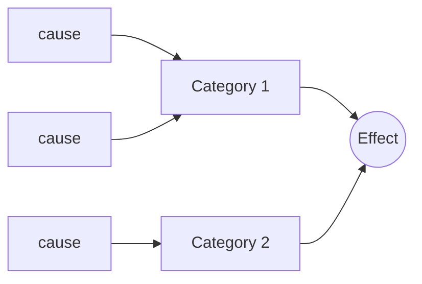

# Ishikawa Diagram

Turn the user's problem into a fishbone of candidate root causes grouped by category, and a plan to verify the most likely ones.

## Input

Work from the user's context (incident notes, metrics, logs, conversation). Infer what you can and state assumptions. Ask only for gaps that block a correct diagram (one round, max 3 questions). The minimum input is the problem (the effect).

## Steps

1. **Define the effect.** Write the problem as a specific, observable statement (what, where, since when, how much).
2. **Pick categories.** Choose 3-6 categories that fit the domain. Use the generic set (People, Methods, Equipment, Materials, Measurement, Environment) or domain-specific ones (e.g. for software: Code, Infrastructure, Process, Data, Dependencies, Users).
3. **Find causes.** Under each category, ask "why could this be happening?" Add every plausible cause. For each cause, ask "why?" again to reach a deeper sub-cause. A problem can have several root causes; capture partial causes too. Done when each category has its causes or an explicit "none found".
4. **Analyze.** For each candidate root cause, rate likelihood based on the evidence in the input, and name the evidence that would confirm or reject it. Done when every candidate has a rating and a check.
5. **Plan.** Order the checks: most likely and cheapest first.

## Output

````markdown
## Effect
<problem statement>

## Fishbone


## Candidate root causes
| Category | Cause | Sub-cause (why?) | Likelihood | Evidence to check |
|---|---|---|---|---|

## Verification plan
1. <check> - confirms/rejects <cause>
````

## Related

- `first-principles` (Five Whys) to dig one cause deeper.
- `iceberg-model` when the problem keeps recurring.
- `issue-trees` for a MECE breakdown instead of categories.

Source: https://untools.co/ishikawa-diagram/
