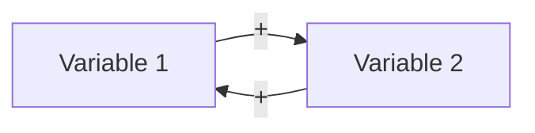

# Reinforcing Feedback Loop

Turn the user's situation into an explicit reinforcing loop: its variables, its direction, the external factors that set its speed, its limits, and where to intervene.

## Input

Work from the user's context. Infer what you can and state assumptions. Ask only for gaps that block a correct loop (one round, max 3 questions). The minimum input is the thing that grows or declines.

## Steps

1. **Variables.** Identify the 2-5 variables inside the loop, as nouns that increase or decrease (e.g. "account balance", "interest earned").
2. **Loop.** Write the cycle: how more of each variable produces more (or less) of the next, until it returns to the first. Confirm it reinforces: an even number of opposite-direction links. Done when the cycle closes and each link has a mechanism.
3. **Direction.** Say whether it currently runs as a virtuous cycle (growth the user wants) or a vicious cycle (decline or growth the user does not want), with evidence.
4. **External factors.** Name the variables outside the loop that set its speed without changing its mechanism (e.g. interest rate, market size, cost of acquisition).
5. **Limits.** Identify the balancing forces that will eventually slow it (capacity, saturation, resources). Reinforcing loops rarely run forever.
6. **Intervene.** To speed a virtuous loop: strengthen the weakest link or the external accelerator, and push back the limits. To break a vicious loop: cut or reverse one link, or add a balancing loop.

## Output

````markdown
## Loop

<one-sentence description of the cycle>

## Direction
<virtuous / vicious> - <evidence>

## External factors
- <factor> - <effect on speed>

## Limits
- <balancing force>

## Interventions
1. <action> - <which link it changes>
````

## Related

- `balancing-feedback-loop` for the forces that limit it.
- `connection-circles` to find the loop in a larger system.

Source: https://untools.co/reinforcing-feedback-loop/
